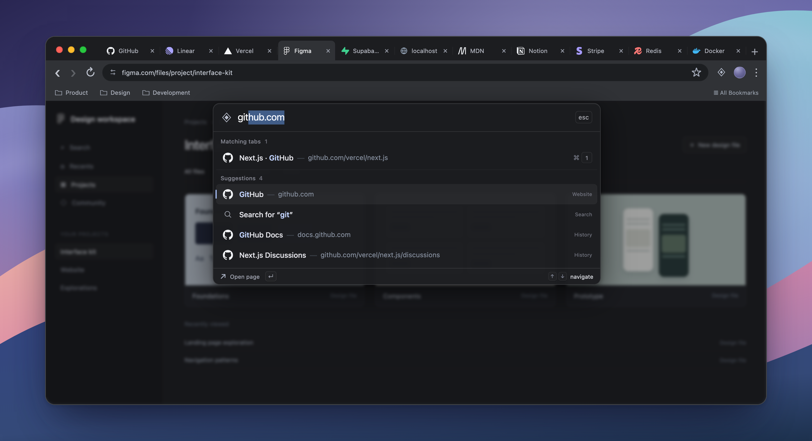

# Tab Palette

An Arc-inspired command bar for Chrome. Press **⌘T** to switch tabs, open a website, or search, without leaving the page you are on.



[Watch the demo](https://github.com/abnerhorn/tab-palette/releases/latest) · [Set up with an agent](docs/AGENT_SETUP.md) · [Manual setup](#manual-setup) · [Privacy](docs/PRIVACY.md)

## How it works

- Your current window’s tabs appear in browser order, with their favicons.
- **⌘1–9**, **⌘0**, then **⌘A…** jump straight to a tab. Labels stay attached to the same tabs while you filter. ⌘T is reserved for toggling the palette.
- Typing filters open tabs and adds suggestions from history, bookmarks, and known hostnames.
- A URL such as `github.com`, `localhost:3000`, or `https://example.com/docs` opens the website. Other text searches with your Chrome default search engine.
- Arrow keys or **Ctrl+N / Ctrl+P** select a result; **Return** opens it; **Escape** dismisses the palette.

Tab selection activates the existing tab. Website and search actions open a new tab. Pinned tabs and collapsed tab groups are supported. After the single-character shortcuts run out, labels use two characters: hold ⌘ and type both. An ambiguous single character resolves on modifier release or after 650 ms.

Chrome does not expose its native address-bar suggestions to extensions. This recreates that interaction using local browser data; optional Google autocomplete is off by default.

## Requirements

The full experience requires **macOS 14 or later**, **Google Chrome 120 or later**, **Python 3.8 or later**, and Apple’s **Xcode Command Line Tools**. It works with Apple silicon and Intel Macs by compiling the companion locally. Node.js 20+ is needed only for development checks.

The extension can also run without the companion. That mode opens a temporary New Tab relay before the palette appears, and uses **Option** instead of **Command** for tab shortcuts. Exact ⌘T interception without that flash requires the macOS companion and your Accessibility approval. Other Chromium browsers, Windows, and Linux native companions are not supported by this installer.

This is a source install, not a Chrome Web Store package or notarized binary. No account, API key, subscription, or browser-data migration is needed. The installer uses user-owned paths and does not require sudo; macOS may ask you to authenticate when granting Accessibility.

## Manual setup

### 1. Keep a local copy

Clone this repository into a permanent folder. Chrome loads the extension from there, so do not move or delete it after setup.

```sh
git clone https://github.com/abnerhorn/tab-palette.git
cd tab-palette
```

If needed, install Apple’s compiler tools with `xcode-select --install`, finish the macOS installer, and make sure `python3 --version` works.

### 2. Install the companion

Inspect the plan, then apply it:

```sh
python3 install.py
python3 install.py --apply
```

This builds the local Swift app in a temporary directory, installs it at `~/Applications/Tab Palette Companion.app`, and registers a native-messaging host for Chrome. It also installs a private UI cache and wrapper under `~/Library/Application Support/Tab Palette`. It does not edit your Chrome profile files.

### 3. Load the extension

1. Open `chrome://extensions` in the Chrome profile you want to use.
2. Turn on **Developer mode**.
3. Click **Load unpacked** and choose this repository’s **`extension`** folder.
4. Check that its ID is **`kbpdjjioplffgdanficjaoccbhlkjfcg`**.
5. If Chrome asks whether to keep the changed New Tab page, choose **Keep it**.

The checked-in manifest key is a **public key**, used to keep this ID stable. There is no private signing key in this repository. If you deliberately change the extension ID, register the matching origin with `python3 install.py --apply --extension-id YOUR_EXTENSION_ID`.

### 4. Enable exact ⌘T

Open **System Settings → Privacy & Security → Accessibility**. Add **`~/Applications/Tab Palette Companion.app`** with the **+** button and enable its switch. The app is in your user Applications folder, which may differ from the system `/Applications` folder. In the file picker, **⌘⇧G** lets you paste the path.

You must complete this macOS approval yourself. Return to Chrome, then open the palette using its toolbar button or **⌘⇧K**. The extension’s **Options** page should report **“Direct Cmd+T capture is active.”** If it does not connect after approval, reload the extension and check again.

### 5. Try it

With an ordinary Chrome window in front, press ⌘T. The palette should appear over the current page with no new tab flashing. Try a tab shortcut, a title fragment, and `example.com`. Press Escape to dismiss.

## Set up with an agent

Give your agent the [setup prompt and checklist](docs/AGENT_SETUP.md). It can clone, inspect, build, and register the companion, then guide you through Chrome’s unpacked-extension picker and the macOS Accessibility approval.

## Updates

**Upgrading from the private prototype?** Version 1.1.0 adds a native focused-window safety check. Remove the old unpacked extension, run `python3 install.py --apply --rebuild-native` from this repository, load this repository’s `extension/` folder, and re-add the installed app in Accessibility. Reloading an old extension card does not change its source folder. Removing the extension leaves your browser tabs, history, and bookmarks intact. Older companions are not compatible with this public version.

```sh
git pull --ff-only
python3 install.py --apply
```

Then click **Reload** on the extension’s `chrome://extensions` card. UI-only updates preserve the installed companion’s signature and Accessibility grant. If a release changes native Swift code, disable the extension, then follow its release notes and rebuild explicitly:

```sh
python3 install.py --apply --rebuild-native
```

Enable the extension again afterward. An ad-hoc native rebuild can change the identity macOS approved. Remove the old Accessibility entry, add the installed app again, and enable it. A blue switch on an old entry can still refer to an obsolete binary.

## Troubleshooting and removal

See [Troubleshooting](docs/TROUBLESHOOTING.md) for a new-tab flash, missing companion, shortcut conflicts, multiple profiles, and clean removal.

The extension replaces New Tab, so another New Tab extension may conflict. Incognito is not supported. While the native palette is open, its ⌘letter shortcuts select tabs, including letters normally used by editing commands. Plain letters still type into search.

## Privacy and permissions

Tab Palette reads tab metadata, history, bookmarks, and Chrome-cached favicons to build suggestions. It has no analytics, remote code, cookie/password access, page-content access, or external favicon service. The native bridge uses local standard input/output. Optional Google autocomplete sends your typed query to Google only after you enable it and grant its separate permission. Submitted searches use your default search engine. See the [permission-by-permission explanation](docs/PRIVACY.md).

## Development

```sh
node --test tests/*.test.mjs
python3 -m py_compile install.py companion/bundle_native.py
python3 -m unittest discover -s tests -p 'test_*.py'
bash companion/build.sh
```

The native app supports `--self-test`, a headless WebKit/bridge check that does not request Accessibility or connect to Chrome. See [Architecture and development](docs/DEVELOPMENT.md) for the protocol, build output, tests, and demo source.

MIT licensed. Built by [Abner Horn](https://github.com/abnerhorn). Inspired by Arc and Raycast; independent of Arc, Raycast, Google, and Apple.
